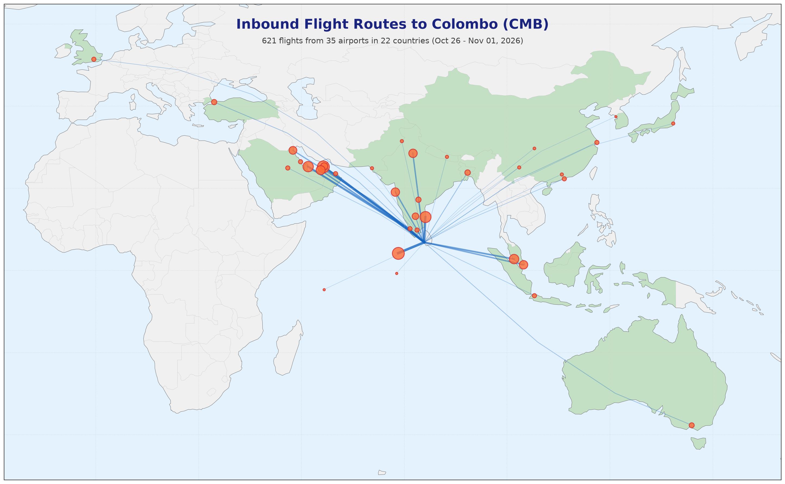

# Air Travel in 🇱🇰 Sri Lanka (lk_air_travel)




## Introduction

This repository provides automated tracking of inbound flight schedules to Colombo's Bandaranaike International Airport (CMB). Flight data is fetched from the official airport website and updated daily via GitHub Actions.

**Data Source:** <https://www.airport.lk>

**Note on Multi-Leg Flights:** For flights that make intermediate stops before arriving in Colombo (e.g., a flight from Dubai stopping in Male), the origin airport is recorded as the last stop before Colombo (Male), not the initial departure point (Dubai). This reflects the actual boarding location for the final leg to Colombo.

Each flight record includes:
- Flight number and airline
- Aircraft type
- Arrival time (Sri Lanka timezone)
- Origin airport with country and coordinates

### Example Flight Data

```json
{
  "flight_no": "UL232",
  "airline": "Srilankan Airlines",
  "aircraft_type": "A32A",
  "arrival_time": "2026-11-01 23:50",
  "airport_name": "Dubai",
  "country_name": "United Arab Emirates"
}
```

## Summary Statistics

**Scheduled flights for the week: 2026-10-26 to 2026-11-01**

- **642** total flights
- **48** origins
- **22** countries
- **32** airlines

## Airlines

| # | Airline | Flights/Week |
|---:|---------|-------------:|
| 1 | Srilankan Airlines | 258 |
| 2 | Indigo Airlines | 61 |
| 3 | Fly Dubai | 28 |
| 4 | Qatar Airways | 28 |
| 5 | Air India | 28 |
| 6 | Etihad Airways | 27 |
| 7 | Fits Air | 23 |
| 8 | Emirates | 21 |
| 9 | Air Arabia | 20 |
| 10 | Air Asia Berhad | 14 |
| 11 | China Eastern | 12 |
| 12 | Turkish Airlines | 11 |
| 13 | Malaysia Airlines | 10 |
| 14 | Jazeera Airways | 9 |
| 15 | Kuwait Airways | 8 |
| 16 | Thai Airways | 7 |
| 17 | Salam Air | 7 |
| 18 | Gulf Air | 7 |
| 19 | Air China | 7 |
| 20 | THAI AIR ASIA | 7 |
| 21 | Cathay Pacific | 7 |
| 22 | Singapore Airlines | 7 |
| 23 | Chongqing Airlines | 6 |
| 24 | Air Arabia Abu Dhabi | 5 |
| 25 | Batik Air | 4 |
| 26 | Vietnam Airlines | 3 |
| 27 | Edelweiss Air | 3 |
| 28 | British Airways | 3 |
| 29 | Jetstar Airways | 3 |
| 30 | Viet Jet | 3 |
| 31 | Aeroflot | 3 |
| 32 | Air Seychelles | 2 |

## Countries

| # | Country | Destinations | Flights/Week |
|---:|---------|-------------:|-------------:|
| 1 | 🇮🇳 India | 7 | 167 |
| 2 | 🇦🇪 United Arab Emirates | 3 | 101 |
| 3 | 🏳️ Unknown | 13 | 84 |
| 4 | 🇲🇻 Maldives | 2 | 56 |
| 5 | 🇲🇾 Malaysia | 1 | 42 |
| 6 | 🇶🇦 Qatar | 1 | 35 |
| 7 | 🇰🇼 Kuwait | 1 | 22 |
| 8 | 🇸🇬 Singapore | 1 | 21 |
| 9 | 🇨🇳 China | 4 | 20 |
| 10 | 🇧🇩 Bangladesh | 1 | 14 |
| 11 | 🇸🇦 Saudi Arabia | 2 | 14 |
| 12 | 🇦🇺 Australia | 1 | 13 |
| 13 | 🇬🇧 United Kingdom | 1 | 9 |
| 14 | 🇵🇰 Pakistan | 2 | 8 |
| 15 | 🇴🇲 Oman | 1 | 7 |
| 16 | 🇮🇩 Indonesia | 1 | 7 |
| 17 | 🇭🇰 Hong Kong | 1 | 7 |
| 18 | 🇳🇵 Nepal | 1 | 4 |
| 19 | 🇯🇵 Japan | 1 | 4 |
| 20 | 🇷🇺 Russia | 1 | 3 |
| 21 | 🇸🇨 Seychelles | 1 | 2 |
| 22 | 🇰🇷 South Korea | 1 | 2 |

## Inbound Locations

| # | Country | Origin | Flights/Week |
|---:|---------|--------|-------------:|
| 1 | 🇲🇻 Maldives | Male | 54 |
| 2 | 🇦🇪 United Arab Emirates | Dubai | 49 |
| 3 | 🇮🇳 India | Chennai | 48 |
| 4 | 🇮🇳 India | Delhi | 42 |
| 5 | 🇲🇾 Malaysia | Kuala Lumpur | 42 |
| 6 | 🇶🇦 Qatar | Doha | 35 |
| 7 | 🇦🇪 United Arab Emirates | Abu Dhabi | 32 |
| 8 | 🏳️ Unknown | Bangkok | 28 |
| 9 | 🇮🇳 India | Mumbai | 28 |
| 10 | 🇮🇳 India | Bangalore | 24 |
| 11 | 🇰🇼 Kuwait | Kuwait | 22 |
| 12 | 🇸🇬 Singapore | Singapore | 21 |
| 13 | 🇦🇪 United Arab Emirates | Sharjah | 20 |
| 14 | 🇧🇩 Bangladesh | Dhaka | 14 |
| 15 | 🇦🇺 Australia | Melbourne | 13 |
| 16 | 🏳️ Unknown | Istanbul | 11 |
| 17 | 🇮🇳 India | Hyderabad Intl | 11 |
| 18 | 🇬🇧 United Kingdom | London-Heathrow | 9 |
| 19 | 🏳️ Unknown | Tiruchchirapalli | 8 |
| 20 | 🇴🇲 Oman | Muscat | 7 |
| 21 | 🇸🇦 Saudi Arabia | Dammam | 7 |
| 22 | 🇸🇦 Saudi Arabia | Riyadh | 7 |
| 23 | 🇮🇳 India | Madurai | 7 |
| 24 | 🇮🇳 India | Cochin | 7 |
| 25 | 🇮🇩 Indonesia | Jakarta | 7 |
| 26 | 🇨🇳 China | Shanghai | 7 |
| 27 | 🏳️ Unknown | Chengdu Tianfu | 7 |
| 28 | 🇭🇰 Hong Kong | Hong Kong | 7 |
| 29 | 🏳️ Unknown | Ho Chi Minh Intl | 6 |
| 30 | 🇨🇳 China | Kunming | 5 |
| 31 | 🇨🇳 China | Guangzhou Baiyun | 5 |
| 32 | 🇵🇰 Pakistan | Karachi | 4 |
| 33 | 🇵🇰 Pakistan | Lahore | 4 |
| 34 | 🏳️ Unknown | Trivandrum | 4 |
| 35 | 🇳🇵 Nepal | Kathmandu | 4 |
| 36 | 🇯🇵 Japan | Narita | 4 |
| 37 | 🏳️ Unknown | Sydney Airport | 4 |
| 38 | 🏳️ Unknown | Ahmedabad Intl | 3 |
| 39 | 🏳️ Unknown | Frankfurt | 3 |
| 40 | 🏳️ Unknown | Zurich | 3 |
| 41 | 🏳️ Unknown | Gatwick Airport | 3 |
| 42 | 🇨🇳 China | Chongqing | 3 |
| 43 | 🇷🇺 Russia | Sheremetyevo | 3 |
| 44 | 🇸🇨 Seychelles | Seychelles | 2 |
| 45 | 🏳️ Unknown | Paris Charles de Gaulle Airport | 2 |
| 46 | 🏳️ Unknown | Frankfurt Airport | 2 |
| 47 | 🇰🇷 South Korea | Incheon | 2 |
| 48 | 🇲🇻 Maldives | Gan Intl | 2 |

---


[](https://opensource.org/licenses/MIT)
